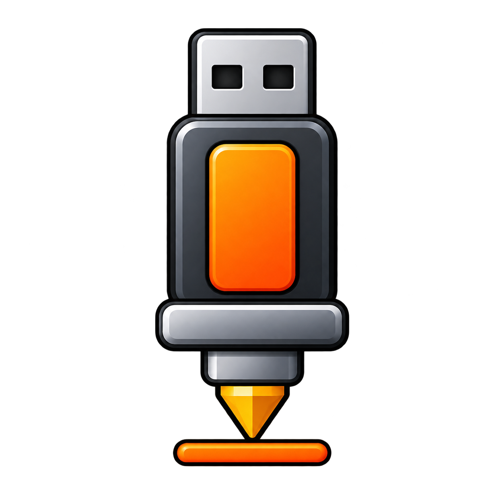

#   Prusa Storage Drive Letter or "PrusaDrive"

Create a mapped drive to multiple Prusa printers USB storage

This is an entirely LAN solution, it works offline as in no cloud or Internet dependancy

 - Modify either of the printers.example-*.json with the details of your printer(s), save this as printers.json
 - Place <b>printers.json</b> and <b>PrusaDrive.exe</b> in the same folder and run it, the drive letter is created automatically, the sub-folder(s) are the name of your printer(s) from the .json file
 - Enjoy coping files to/from the USB stick without wearing out the USB port anymore!
 - Click on the system tray icon to open the drive letter
 - Right-click on the system tray icon and pick Exit (Unmount Drive) to close
 - Optionally put a shortcut to PrusaDrive.exe in your startup folder if you want it to run every time you login
 - If PrusaDrive.exe is already running, and you run it again, the drive letter opens

Prerequisites to run the EXE:

 - [PrusaLink](https://help.prusa3d.com/article/prusa-connect-and-prusalink-explained_302608) must be enabled on your printer(s), it's built-in to modern firmware, from the LCD go to Settings > Network > PrusaLink > Enable it and make note of the password and IP address of your printer, this requires HTTP port 80 be accessible on the LAN between the printers and your Windows machine
 - [winfsp-2.1.25156.msi](https://github.com/winfsp/winfsp/releases/download/v2.1/winfsp-2.1.25156.msi) must be installed on the Windows machine where you want to run PrusaDrive.exe

Additional prerequisites only if you want to build the EXE yourself:
 
 - [python-3.11.9-amd64.exe](https://www.python.org/ftp/python/3.11.9/python-3.11.9-amd64.exe) should be installed (yes it must be v3.11.9)
 - use py -3.11 -m pip install -r requirements.txt
 - use build_prusadrive.bat

Limitations:

 - Folders on the printers USB stick that have +100 files - wait patiently, it may timeout and not list the files, it may say something about not enough permissions but that is not accurate
 - Windows file copy percentage/graph cannot be made more accurate - this is why the system tray icon shows an upload progress bar
 - Cannot create new folders on the USB stick - not supported, insert the USB stick in your computer instead
 - Cannot copy files off of the USB stick, to your computer or to another printer - not supported, insert the USB stick in your computer instead
 - Cannot overwrite or delete a file that is currently displayed on the printers LCD display - the file is in use, go back to the home screen (or stop printing that file), then it will work

Tested with Prusa XL firmware 6.4.1, MK4S firmware 6.5.3, COREONE firmware 6.5.3 - if API endpoints change in later versions this software will have to be updated

If you really love this and it saves you time, consider buying something from me on [Printables](https://www.printables.com/@JPMakesStuff) or [Etsy](https://jpelectron.etsy.com/)

[END]
